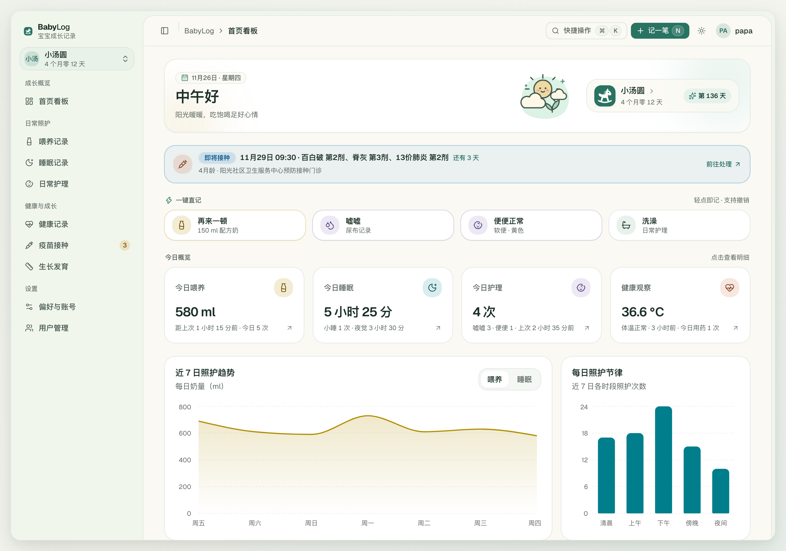
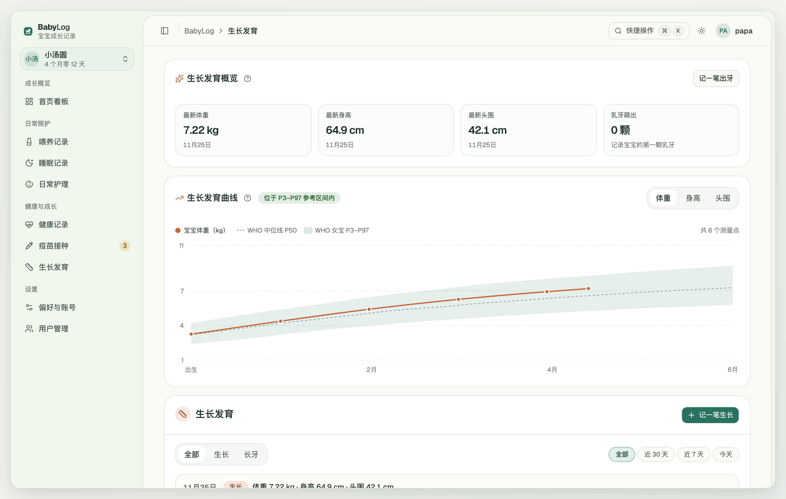
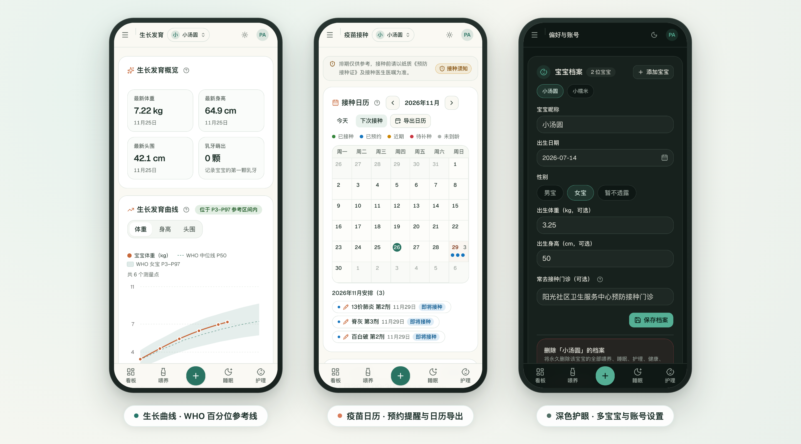

<div align="center">


<br />

<h1>
  
  &nbsp;BabyLog
</h1>

<p><strong>奶爸视角的开源自托管宝宝日常记录应用</strong></p>
<p>把喂养、睡眠、护理与健康点滴留在自己家里——单手 3 秒记完，昼夜护眼不刺眼，零云端依赖。</p>

<p>
  <a href="https://github.com/nt1r/babylog/actions/workflows/ci.yml"></a>
  <a href="https://github.com/nt1r/babylog/releases"></a>
  <a href="https://github.com/nt1r/babylog/pkgs/container/babylog"></a>
  <a href="./LICENSE"></a>
</p>

<p>
  <a href="#界面预览">界面预览</a> ·
  <a href="#核心亮点">核心亮点</a> ·
  <a href="#快速自部署">快速自部署</a> ·
  <a href="#进阶运维与反代配置">反代与备份</a> ·
  <a href="#本地开发与源码构建">本地开发</a> ·
  <a href="#功能规划">功能规划</a>
</p>

</div>

---

## 为什么做 BabyLog？

深夜两点，一只手抱着刚喝完奶的宝宝，另一只手想快速记下「配方奶 140 ml」——却被刺眼的白底弹窗、开屏广告和繁琐表单劝退；更不想把宝宝每天的吃喝拉撒、体温和生长数据交给来路不明的商业云端。

**BabyLog** 由此诞生：

- **只为自家服务**：无开放注册、无广告、无数据上报，单一零 CGO Go 二进制 + SQLite 轻量运行，家庭数据牢牢掌握在自己的 NAS 或小服务器上。
- **为真实带娃场景打磨**：鼠尾草绿与暖米白绘本调性，配合深夜护眼深色模式、PWA 桌面安装、智能默认值回填与移动端单手底部抽屉，真正做到掏出手机 3 秒记完。

---

## 界面预览

### 昼夜双色桌面看板

白天是克制温柔的**暖米白 + 鼠尾草绿**绘本画布，夜晚一键切入低眩光的**深森绿灰护眼主题**（支持跟随系统、首屏无闪烁）。左侧支持多宝宝切换与分类导航，顶部提供 `⌘K` 快捷命令面板与一键记一笔；首页聚合今日喂养/睡眠/护理/体温 KPI、近期疫苗预约提醒、一键直记、近 7/14 日趋势曲线与全天照护节律。

<p align="center">
  
  <br />
  <sub>☀️ <strong>浅色模式</strong> — 暖米白纸感画布、多宝宝切换、疫苗到期提醒、一键直记与低饱和分类色</sub>
</p>

<br />

<p align="center">
  
  <br />
  <sub>🌙 <strong>深色护眼模式</strong> — 为深夜起夜喂奶校准柔和对比度，暗光环境下同样清晰舒适</sub>
</p>

### 疫苗接种计划与 WHO 生长曲线

内置国家免疫规划疫苗懒初始化、常见自费疫苗模板与自定义计划，提供接种日历、月龄时间线、常去门诊管理、一键批量标记已接种及 `.ics` 日历导出；独立的「生长发育」页提供身高、体重、头围记录管理，并自动叠加 **WHO 儿童生长百分位参考区间（P3–P97 与 P50 中位线）**。

<p align="center">
  
  <br />
  <sub>💉 <strong>疫苗接种管理</strong> — 接种日历、下次接种倒计时与一键已接种、免费/自费进度统计及 <code>.ics</code> 日历导出</sub>
</p>

<br />

<p align="center">
  
  <br />
  <sub>📏 <strong>WHO 生长发育曲线</strong> — 支持体重、身高、头围切换与 WHO 性别百分位参考区间直观对照</sub>
</p>

### 多用户行级隔离与多宝宝管理

面向家庭自托管设计，无开放注册入口。唯一管理员可通过 Web「用户管理」或 CLI 为不同家庭创建、停用与重置独立账号（支持强制首次改密与自助改密）；每个账号可管理最多 **10 个宝宝档案**并随时在顶部/侧栏切换，跨账号数据在数据库查询与写入层严格行级隔离，管理员也无法查看其他账号的宝宝档案与记录。

<p align="center">
  
  <br />
  <sub>👨‍👩‍👧‍👦 <strong>多户多娃隔离管理</strong> — 账号生命周期管理（正常 / 待改密 / 已停用）与跨家庭隐私严格隔离</sub>
</p>

### 移动端 PWA · 日常快录与生长免疫双三连屏

支持添加到 iOS / Android 主屏幕作为 PWA 使用，完整适配安全区与底部 5 槽位单手导航。顶部随时切换宝宝，点击底部中央 `+` 唤起**底部滑出抽屉**，自动预填宝宝常用奶量、建议亲喂侧别与时间快捷偏移；同时在手机端完整覆盖 WHO 生长曲线、疫苗日历提醒与深色护眼下的多宝宝设置。

<p align="center">
  
  <br />
  <sub>📱 <strong>移动端三连屏 · 日常 3 秒快录</strong> — 多娃切换与实时看板 · 底部单手智能回填抽屉 · 分类列表按日自动汇总小计</sub>
</p>

<br />

<p align="center">
  
  <br />
  <sub>📱 <strong>移动端三连屏 · 生长免疫与夜间护眼</strong> — WHO 百分位生长曲线 · 疫苗接种日历与提醒 · 深色护眼多宝宝档案设置</sub>
</p>

---

## 核心亮点

<table>
  <tr>
    <td width="50%" valign="top">
      <h3>🍼 3 秒单手快录 & 智能回填</h3>
      <p>覆盖 <strong>喂养</strong>（亲喂/瓶喂母乳/配方奶/辅食）、<strong>睡眠</strong>（小睡/夜觉跨夜切分）、<strong>护理</strong>（尿布性状颜色/洗澡/自定义）与 <strong>健康</strong>（体温/用药/出牙）。自动记住常用奶量、上次亲喂侧别与常用药品，配合「一键直记」、时间偏移与桌面 <code>⌘K</code> 快捷命令面板大幅减少输入。</p>
    </td>
    <td width="50%" valign="top">
      <h3>📈 趋势洞察 & WHO 生长曲线</h3>
      <p>首页看板实时计算宝宝月龄天数、距上次喂养/换尿布时长与今日汇总，提供近 7/14 日趋势图与全天 5 时段照护节律；独立「生长发育」页支持身高、体重、头围记录并叠加 <strong>WHO 百分位参考区间</strong>，清晰追踪发育曲线。</p>
    </td>
  </tr>
  <tr>
    <td width="50%" valign="top">
      <h3>💉 疫苗接种计划 & 多态提醒</h3>
      <p>按宝宝出生日期自动懒初始化国家免疫规划疫苗，内置常见自费疫苗模板与自定义接种计划；支持默认接种门诊、日历与月龄时间线双视图、一键批量完成/预约、首页临期提醒及 <code>.ics</code> 日历导出。</p>
    </td>
    <td width="50%" valign="top">
      <h3>👨‍👩‍👧‍👦 多用户隔离 & 多宝宝管理</h3>
      <p>无开放注册，唯一管理员可通过 CLI 或 Web「用户管理」为不同家庭创建独立账号（支持强制/自助改密与即时停用吊销会话）；每账号支持管理最多 10 个宝宝档案并随时切换，跨账号行级严格隔离且管理员无法查看他人数据。</p>
    </td>
  </tr>
  <tr>
    <td width="50%" valign="top">
      <h3>🔒 本地优先与安全基线</h3>
      <p>所有育儿数据仅存于本地 SQLite（WAL 模式），零云端依赖；采用加盐 <code>scrypt</code> 密码派生与常量时间比较、登录防爆破限流、<code>HttpOnly; SameSite=Strict</code> 会话 Cookie（支持 <code>BABYLOG_COOKIE_SECURE</code>）与写接口 Same-Origin 校验。</p>
    </td>
    <td width="50%" valign="top">
      <h3>🪶 零 CGO 单二进制 · 极简更新</h3>
      <p>后端使用 Go + 零 CGO SQLite 并通过 <code>embed.FS</code> 内嵌前端打包为单二进制；提供多架构 GHCR Docker 镜像、一键安装脚本与 SQLite 合并备份脚本，部署 <code>latest</code> 时只需 <code>docker compose up -d --force-recreate --wait</code> 单命令平滑更新。</p>
    </td>
  </tr>
</table>

---

## 快速自部署

### 一键安装 / 升级脚本（推荐）

要求服务器已安装 **Docker Engine** 与 **Docker Compose v2**。脚本会从 `main` 分支拉取官方 [compose.yaml](./compose.yaml) 与预构建多架构镜像（`linux/amd64`、`linux/arm64`），引导配置目录与端口，并安全交互式初始化管理员密码（不落盘宿主机明文密码文件）：

```sh
curl -fsSL https://raw.githubusercontent.com/nt1r/babylog/main/scripts/install.sh | sh
```

常用参数与平滑升级：

```sh
# 原地升级到最新版本（保留现有数据卷与 .env 配置）
curl -fsSL https://raw.githubusercontent.com/nt1r/babylog/main/scripts/install.sh | sh -s -- --upgrade

# 指定版本、安装目录或监听地址（局域网直连可用 --bind 0.0.0.0）
curl -fsSL https://raw.githubusercontent.com/nt1r/babylog/main/scripts/install.sh | sh -s -- \
  --dir /opt/babylog --version v0.1.0 --bind 127.0.0.1 --port 21115
```

> 如需先审查脚本再执行，可下载脚本或从 [GitHub Releases](https://github.com/nt1r/babylog/releases) 获取随版本发布的 `install.sh` 与 `SHA256SUMS.txt` 校验后运行。

<details>
<summary><strong>方式二：手动 Docker Compose 部署</strong></summary>

<br />

```bash
mkdir -p /opt/babylog && cd /opt/babylog
curl -fsSLO https://raw.githubusercontent.com/nt1r/babylog/main/compose.yaml

# 1. 拉取预构建镜像
docker compose pull

# 2. 首次部署：交互式初始化管理员账号（密码长度 12–1024 字符，不落盘宿主机明文文件）
read -rsp "输入 BabyLog 管理员密码: " BABYLOG_PASS; echo
printf '%s\n' "$BABYLOG_PASS" | docker compose run --rm -T --no-deps --entrypoint sh babylog -c '
  set -eu
  umask 077
  trap "rm -f /tmp/babylog-init.pass" EXIT
  cat > /tmp/babylog-init.pass
  /usr/local/bin/babylog admin init --password-file /tmp/babylog-init.pass --username admin
'
unset BABYLOG_PASS

# 3. 启动服务
docker compose up -d
```

SQLite 数据库持久化保存在 Docker 命名卷 `babylog_data`（挂载至容器内 `/data`，归属 UID `1000`）。可在同目录创建 `.env` 覆盖默认配置：

```dotenv
BABYLOG_IMAGE=ghcr.io/nt1r/babylog
BABYLOG_VERSION=latest
BABYLOG_BIND=127.0.0.1
BABYLOG_PORT=21115
# 运行在 HTTPS 反向代理之后时可设为 true，由应用直接下发 Secure 会话 Cookie
BABYLOG_COOKIE_SECURE=false
```

官方 [compose.yaml](./compose.yaml) 已配置 `pull_policy: always` 与 `stop_grace_period: 15s`。当部署 `latest`（默认）并需要更新到最新发布版本时，直接在部署目录执行单条命令即可拉取最新镜像、平滑重建容器并等待健康检查通过（数据卷内的 SQLite 数据库自动保留并按需完成迁移）：

```bash
docker compose up -d --force-recreate --wait

# 核对运行版本（启动日志与 CLI 均会输出版本号与提交哈希）
docker compose logs --tail=20 babylog
docker compose exec babylog babylog version

# 可选：清理升级后残留的旧悬空镜像
docker image prune -f
```

> 若本次更新同时涉及官方 `compose.yaml` 模板调整，建议改用上方的 `install.sh --upgrade` 一键同步模板并升级。

</details>

<details>
<summary><strong>方式三：GitHub Release 单二进制运行（无 Docker）</strong></summary>

<br />

从 [GitHub Releases](https://github.com/nt1r/babylog/releases) 下载对应平台（`linux/amd64`、`linux/arm64`、`darwin/amd64`、`darwin/arm64`）的压缩包与 `SHA256SUMS.txt`：

```bash
# 校验并解压（macOS 可用 shasum -a 256 -c --ignore-missing SHA256SUMS.txt）
sha256sum -c --ignore-missing SHA256SUMS.txt
tar -xzf babylog_v0.1.0_linux_amd64.tar.gz

# 查看版本
./babylog version

# 初始化管理员（PASSWORD_FILE 须放在安全目录且权限为 0600，长度 12–1024 字符）
BABYLOG_DATA_DIR=/var/lib/babylog ./babylog admin init --password-file /path/to/init.pass --username admin

# 可选：通过 CLI 管理家庭账号（也可登录管理员后在 Web 端「用户管理」操作）
BABYLOG_DATA_DIR=/var/lib/babylog ./babylog user create --username alice --password-file /path/to/alice.pass --force-change
BABYLOG_DATA_DIR=/var/lib/babylog ./babylog user list
BABYLOG_DATA_DIR=/var/lib/babylog ./babylog user reset-password --username alice --password-file /path/to/new.pass --force-change
BABYLOG_DATA_DIR=/var/lib/babylog ./babylog user disable --username alice
BABYLOG_DATA_DIR=/var/lib/babylog ./babylog user enable --username alice

# 启动服务（默认监听 127.0.0.1:21115；HTTPS 反代部署可开启 BABYLOG_COOKIE_SECURE=true）
BABYLOG_DATA_DIR=/var/lib/babylog GIN_MODE=release ./babylog serve
```

</details>

---

## 进阶运维与反代配置

默认配置仅监听 `127.0.0.1:21115`，公网访问建议通过宿主机反向代理启用 HTTPS，并定期备份本地 SQLite 数据。

<details>
<summary><strong>HTTPS 反向代理配置（Caddy / Nginx）</strong></summary>

<br />

### Caddy 示例

```caddyfile
baby.example.com {
	encode zstd gzip

	header {
		Strict-Transport-Security "max-age=31536000; includeSubDomains"
		X-Content-Type-Options "nosniff"
		Referrer-Policy "strict-origin-when-cross-origin"
	}

	reverse_proxy 127.0.0.1:21115 {
		# 后端内网走 HTTP，由反代补齐会话 Cookie 的 Secure 标记
		header_down Set-Cookie "(?i)(^babylog_session=.*)" "$1; Secure"
	}
}
```

### 反向代理注意事项

- **强制 `Secure` Cookie**：若 BabyLog 运行在 HTTPS 反向代理之后，可直接为后端设置环境变量 `BABYLOG_COOKIE_SECURE=true`（应用将直接下发带 `Secure` 标记的 `babylog_session` Cookie，不再依赖反代改写响应头），或在 Caddy/Nginx 中补齐 `Secure` 属性。
- **保留原始 `Host` 头**：所有写接口均启用 Same-Origin 校验，Caddy 默认透传 `Host`；若使用 Nginx，须显式设置 `proxy_set_header Host $http_host;`。
- **透传缓存头**：请勿在反代层覆盖后端返回的 `Cache-Control`（`/api/*` 为 `no-store`，`index.html`/`sw.js`/`manifest.webmanifest` 为 `no-cache`，`/assets/*` 为 `immutable`），以确保 iOS / Android PWA 正常更新。

</details>

<details>
<summary><strong>远程数据库一键备份（<code>scripts/backup.sh</code>）</strong></summary>

<br />

在本地克隆仓库后，在根目录创建被 `.gitignore` 忽略的 `.env.deploy`：

```sh
DEPLOY_HOST=user@your-server
DEPLOY_DIR=/opt/babylog
DEPLOY_DOMAIN=baby.example.com
```

执行 [scripts/backup.sh](./scripts/backup.sh) 即可从远程运行中的容器拉取 SQLite 数据库（含 WAL 日志），在本地合并为单文件并执行 `PRAGMA integrity_check` 后保存到 `~/Desktop/babylog-backups/`：

```sh
./scripts/backup.sh
./scripts/backup.sh -o /custom/backup/dir
```

</details>

---

## 本地开发与源码构建

<details>
<summary><strong>查看技术栈、本地开发命令与源码构建 Docker 镜像说明</strong></summary>

<br />

### 技术栈

- **前端**：React 19、Vite 8、TypeScript 7、shadcn（`base-nova`）+ `@base-ui/react`、Tailwind CSS v4、TanStack Router / Query、Zustand、Recharts；Node 26.13.1 LTS（见 [.node-version](./.node-version)）与 pnpm 12.21.0。已安装 NVS 时，`nvs use` 会按 `.node-version` 切换版本。
- **后端**：Go（见 [backend/go.mod](./backend/go.mod)）、Gin、GORM + 零 CGO SQLite（`glebarez/sqlite` / `modernc.org/sqlite`）、`goose` 内嵌迁移、`cobra` CLI、`embed.FS` 单二进制打包。

### 开发命令

```bash
pnpm install
pnpm admin:init --password-file "$PASSWORD_FILE"
pnpm dev
```

`PASSWORD_FILE` 由操作者设置为仓库外已有的私有密码文件。密码长度须为 12–1024 字符，文件末尾仅一个 LF 或 CRLF 会被移除，其余空白原样保留。默认用户名为 `admin`，可用 `--username` 指定；重复执行初始化会拒绝覆盖已有管理员。

数据写入 `data/babylog.sqlite`（已被 `.gitignore` 忽略）；设置 `BABYLOG_DATA_DIR` 可改用其他目录（例如多 worktree 共用 `~/.local/share/babylog-dev`），初始化与运行需使用同一取值。`pnpm dev` 会等待 Go 后端（经 `air` 热重载，默认 `21115` 端口）就绪后再拉起前端页面（`http://127.0.0.1:11115`）；可用 `PORT` 覆盖端口，Vite 代理同步使用该值。

- `pnpm dev:reset-db`：重置本地开发数据库并重新初始化管理员（默认放行 `./data`、`~/.local/share/*dev*` 与临时目录，拒绝在容器或生产环境执行）。
- `pnpm lint`：执行 Biome 检查、工程门禁与 `go vet`。
- `pnpm check`：执行 TypeScript 类型检查。
- `pnpm test`：执行 Go 后端单元与集成测试（`CGO_ENABLED=0`）。
- `pnpm build`：构建前端产物并内嵌打包为单二进制 `bin/babylog`。
- `pnpm start`：运行 `bin/babylog serve` 提供 UI 与 API（21115 端口）。

### 从源码构建 Docker 镜像与远程推送

如需本地直接从源码构建镜像，可叠加 [compose.build.yaml](./compose.build.yaml)：

```bash
docker compose -f compose.yaml -f compose.build.yaml up -d --build
```

维护者也可配合上述 `.env.deploy` 使用 [scripts/deploy.sh](./scripts/deploy.sh) 完成本地检查、白名单源码同步、远程重建容器与健康验证：

```sh
./scripts/deploy.sh              # 默认执行 pnpm lint && pnpm check 后发布
./scripts/deploy.sh --skip-checks
./scripts/deploy.sh --no-cache
```

</details>

---

## 功能规划

- [x] 安全认证与 Cookie 会话管理（加盐 scrypt、防爆破限流、强制/自助改密与 Same-Origin 防护）
- [x] 多账号（一户一账号）与单账号多宝宝隔离管理（CLI + Web 用户管理、强制/自助改密与硬删除级联）
- [x] 宝宝建档、核心日常记录（喂养 / 睡眠 / 排便 / 体温 / 生长发育）与智能默认值
- [x] 疫苗接种计划、国家免疫规划懒初始化、自费模板与多态提醒
- [x] 首页数据看板、近 7/14 日趋势图表与全天照护节律
- [x] PWA 支持、浅色/深色护眼主题与移动端单手录入适配
- [x] Docker Compose / GHCR 多架构镜像、跨平台单二进制发版与一键部署/备份脚本
- [ ] 更多提醒待办（定时用药、儿保体检与自定义待办）

---

## 参与贡献与安全披露

- 贡献流程、分支规范与维护者发版指南请见 [CONTRIBUTING.md](./CONTRIBUTING.md) 与 [AGENTS.md](./AGENTS.md)。
- 视觉与组件规范请见 [docs/design-system.md](./docs/design-system.md)。
- 安全漏洞请勿在公开 Issue 披露，请按 [SECURITY.md](./SECURITY.md) 通过 GitHub Security Advisories 私下报告。
- 本项目基于 [Apache-2.0](./LICENSE) 协议开源。

<details>
<summary><strong>参考文档与致谢</strong></summary>

- Base UI：https://base-ui.com/react/overview/quick-start
- shadcn/ui：https://ui.shadcn.com/docs
- TanStack Router：https://tanstack.com/router/latest
- 设计参考项目：https://github.com/ppxb/continew-ui-next

</details>
